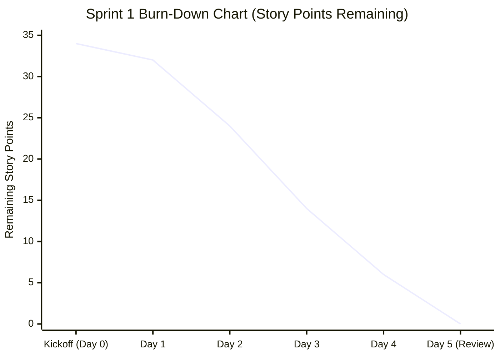

# Mini-Sprint Plan & Daily Updates Log

> **Sprint Name:** Sprint 1 — Version 1 Core Diagnostic Engine  
> **Sprint Duration:** 5 Working Days (1-Week Mini-Sprint)  
> **Team Composition:**  
> - **Dev A (Frontend / UI Lead):** React.js, Tailwind CSS, Recharts, State Management  
> - **Dev B (Backend / Systems Lead):** Node.js, Express, Sockets (`net`, `tls`, `dns`, `http`), SSRF Defense  
> **Sprint Goal:** Deliver an end-to-end working MVP of the Network Diagnostic Engine capable of testing an arbitrary URL, measuring each networking stage (DNS, TCP, TLS, TTFB, Transfer), identifying the slowest bottleneck, and displaying a responsive waterfall chart with diagnostic explanations.

---

## ⏱️ 1. Task Estimation Matrix (Fibonacci Story Points & Hours)

Estimation uses modified Fibonacci points ($1, 2, 3, 5, 8$) where **1 Point $\approx$ 1.5 - 2 Hours of Focused Effort**.

| Task ID | Task Description | Epic / Layer | Dev Owner | Story Points | Est. Hours | Actual Hours | Status |
|---|---|---|---|:---:|:---:|:---:|:---:|
| **NDE-01** | Repository scaffold (Vite + React, Express server, Tailwind) | Setup | Dev A + B | 2 | 3h | 3h | ✅ Completed |
| **NDE-02** | URL validation, protocol check & SSRF mitigation | Backend/Sec | Dev B | 3 | 4h | 4h | ✅ Completed |
| **NDE-03** | DNS resolution timing module (`dns.resolve4` / `dns.lookup`) | Backend | Dev B | 3 | 4h | 3.5h | ✅ Completed |
| **NDE-04** | TCP connect (`net`) & TLS handshake (`tls`) socket timers | Backend | Dev B | 5 | 7h | 7.5h | 🔄 In Progress |
| **NDE-05** | React dashboard wireframe, URL input bar, loading state | Frontend | Dev A | 3 | 4h | 4h | 🔄 In Progress |
| **NDE-06** | HTTP request, TTFB, and data transfer throughput timer | Backend | Dev B | 5 | 6h | 6h | 📋 Sprint Backlog |
| **NDE-07** | Rule-based bottleneck detection algorithm & reasoning rules | Backend/Alg | Dev B + A | 5 | 6h | 6h | 📋 Sprint Backlog |
| **NDE-08** | Interactive Recharts waterfall visualization component | Frontend | Dev A | 5 | 7h | 7h | 📋 Sprint Backlog |
| **NDE-09** | Diagnostic explanation badges & recommendation panels | Frontend | Dev A | 3 | 4h | 4h | 📋 Sprint Backlog |
| **NDE-13** | End-to-end integration, error edge cases & demo testing | QA/Fullstack | Dev A + B | 5 | 6h | 6h | 📋 Sprint Backlog |
| **Total** | | | | **34 SP** | **51h** | | |

*Capacity Calculation:* 2 developers $\times$ 5 days $\times$ 5.5 hours/day $\approx$ 55 hours available capacity. Commitment of 51 estimated hours leaves an optimal ~8% buffer for unexpected bugs and code reviews.

---

## 📅 2. Daily Standup Updates (5-Day Mini-Sprint Execution)

Each daily update follows the standard Agile Scrum standup format:
1. **Yesterday:** What was completed?
2. **Today:** What is planned?
3. **Blockers / Risks:** What is impeding progress?

---

### 🔹 Day 1: Sprint Kickoff & System Architecture Setup
**Focus:** Project structure, environment configuration, and foundational security.

#### Dev A (Frontend)
- **Yesterday:** Finalized UI wireframes and reviewed the course project specification document.
- **Today:**
  - Initialize Vite React project with Tailwind CSS and Lucide icons.
  - Setup folder structure: `/components`, `/services`, `/hooks`, and `/types`.
  - Configure proxy in `vite.config.js` to route `/api` calls to local Express server.
- **Blockers:** None.

#### Dev B (Backend)
- **Yesterday:** Planned the socket measurement sequence (DNS $\rightarrow$ TCP $\rightarrow$ TLS $\rightarrow$ HTTP).
- **Today:**
  - Initialize Express backend with CORS, JSON body parser, and error middleware.
  - Implement **NDE-02 (SSRF Security Filter)**: prevent queries to `127.0.0.1`, `localhost`, `169.254.169.254`, and RFC-1918 private subnets.
- **Blockers:** None.

---

### 🔹 Day 2: Network Socket Timers & UI Input Controls
**Focus:** Low-level network timing modules and front-end user input workflow.

#### Dev A (Frontend)
- **Yesterday:** Completed base React project scaffold with responsive navigation bar and layout container.
- **Today:**
  - Implement **NDE-05**: URL input form with real-time validation (regex for domain/URL, protocol toggle `http://` vs `https://`).
  - Add loading skeletons, submit button state handling, and toast alerts for validation errors.
- **Blockers:** Awaiting sample JSON response schema from Dev B to finalize mock data fixtures.

#### Dev B (Backend)
- **Yesterday:** Finished SSRF filtering module with unit tests for malicious URLs.
- **Today:**
  - Implement **NDE-03 (DNS Resolution Timer)** using `process.hrtime()` around `dns.lookup`.
  - Begin **NDE-04 (TCP & TLS Timers)** using `net.createConnection()` for TCP connect latency and `tls.connect()` for SSL/TLS negotiation.
- **Blockers:** Addressed an issue where TLS handshake timing was influenced by TCP connection setup; resolved by splitting raw socket connect and `tls.connect({ socket })`.

---

### 🔹 Day 3: HTTP/TTFB Measurements & Waterfall Chart Visualization
**Focus:** Full request lifecycle timing and data visualization in React.

#### Dev A (Frontend)
- **Yesterday:** Finished URL input component and animated loading state. Received API contract schema from Dev B.
- **Today:**
  - Implement **NDE-08**: Integrate Recharts to build the horizontal waterfall timing chart.
  - Display individual bars: DNS Resolution $\rightarrow$ TCP Connect $\rightarrow$ TLS Handshake $\rightarrow$ TTFB $\rightarrow$ Content Download.
  - Add tooltips displaying millisecond metrics and percentage of total time.
- **Blockers:** Customizing Recharts stacked bar styling to represent staggered start offsets.

#### Dev B (Backend)
- **Yesterday:** Verified TCP and TLS timing accuracy on benchmark websites (`google.com`, `github.com`).
- **Today:**
  - Implement **NDE-06 (HTTP, TTFB & Download)**:
    - Dispatch HTTP/HTTPS request, measure TTFB (`res.once('readable')` or `data` event).
    - Measure stream completion time, calculate total downloaded bytes and throughput (KB/s).
  - Aggregate all timing metrics into a unified result object.
- **Blockers:** Large response payloads take too long; applied a maximum response stream limit (1 MB) to prevent denial of service.

---

### 🔹 Day 4: Diagnostic Rule Engine & Remediation Cards
**Focus:** Automated bottleneck detection and root cause explanations.

#### Dev A (Frontend)
- **Yesterday:** Built Recharts waterfall component with mock data and responsive legends.
- **Today:**
  - Implement **NDE-09**: Diagnostic summary cards, bottleneck highlight badge (e.g., Red badge for critical bottleneck), and recommendations section.
  - Create visual status indicators (e.g., green check for fast stages, amber for moderate, red for high latency).
- **Blockers:** None.

#### Dev B (Backend)
- **Yesterday:** Completed HTTP/TTFB stream measurement and throughput calculations.
- **Today:**
  - Implement **NDE-07 (Rule-Based Bottleneck Engine)**:
    - *DNS Bottleneck Rule:* If DNS > 250ms or > 30% of total time $\rightarrow$ Flag DNS issue (suggest DNS caching / CDN review).
    - *TCP Bottleneck Rule:* If TCP > 200ms $\rightarrow$ High network latency / geographical distance.
    - *TLS Bottleneck Rule:* If TLS > 300ms $\rightarrow$ Sub-optimal cipher suite or missing TLS session resumption.
    - *TTFB Bottleneck Rule:* If TTFB > 500ms or > 40% of total $\rightarrow$ Slow backend processing or database querying.
    - *Transfer Bottleneck Rule:* If Content Transfer > 50% $\rightarrow$ Uncompressed assets or large payload size.
- **Blockers:** Fine-tuning threshold boundaries to avoid false positives on fast local networks.

---

### 🔹 Day 5: End-to-End Integration, Error Edge-Cases & Demo
**Focus:** Full system integration, error resilience, and sprint review.

#### Dev A (Frontend)
- **Yesterday:** Completed diagnostic cards and recommendation view.
- **Today:**
  - Implement **NDE-13**: Hook frontend service to live backend `/api/diagnose`.
  - Handle error states: connection timeouts, invalid hostnames, SSL certificate expiry, and backend 500 responses.
  - Perform polish on typography, spacing, and mobile responsiveness.
- **Blockers:** None.

#### Dev B (Backend)
- **Yesterday:** Finished rule-based analysis engine and tested diagnostic outputs across diverse URLs.
- **Today:**
  - Add request timeout guard (abort socket after 10 seconds if host doesn't respond).
  - Join Dev A for end-to-end integration and smoke testing against 10 sample test websites.
  - Document API endpoint contract in README.
- **Blockers:** None.

---

## 📈 3. Sprint Burn-Down & Review Summary

### Sprint Review & Demo Checklist
- [x] Input validation blocks empty inputs, invalid URL formats, and local IP addresses (SSRF defense).
- [x] Backend successfully measures DNS, TCP, TLS, TTFB, and Transfer durations with high precision (`hrtime`).
- [x] Rule engine identifies the primary bottleneck stage and provides sensible, human-readable explanations.
- [x] Frontend displays a waterfall breakdown chart and highlights the bottleneck in red.
- [x] System gracefully handles timeouts (10s) and unreachable domains without crashing.

